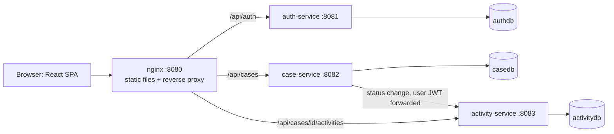
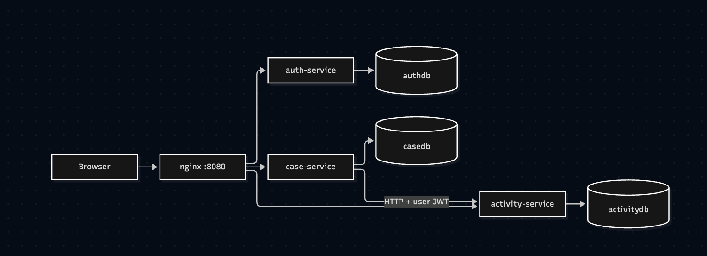

# Banking Case Management Portal

A small internal application for bank employees to manage customer cases: log in, create and update cases, move them through a workflow on a Jira-style board, and record notes and history.

## Features

- JWT login with BCrypt-hashed passwords and role-based access (AGENT, MANAGER)
- Case management: create, list (filters and pagination), view, update, delete
- Jira-style board with drag-and-drop status changes
- Activity timeline per case (notes, customer contacted, documents requested, automatic status-change entries)
- Dashboard with counts by status and priority
- Optimistic locking: concurrent edits are detected instead of silently overwritten

## Architecture




| Component | Responsibility |
|---|---|
| frontend | React + TypeScript SPA, served by nginx, which also proxies `/api` |
| auth-service | Authenticates users, issues JWTs |
| case-service | Case CRUD, workflow rules, pagination, filtering |
| activity-service | Append-only notes and history per case |
| PostgreSQL | One container, three separate databases (one per service) |

See `docs/architecture.md` and `docs/adr/` for the reasoning behind these choices.

## Technology decisions

| Area | Choice | Why |
|---|---|---|
| Backend | Spring Boot 4, Java 21 | Mature, strong security support |
| Database | PostgreSQL, one database per service | Cases and history are relational and need ACID guarantees; per-service databases avoid shared-schema coupling |
| Migrations | Flyway; Hibernate `ddl-auto: validate` | Versioned, repeatable schema changes |
| Auth | JWT (HS256), BCrypt | Stateless, simple to verify in every service |
| Frontend | React, TypeScript, Vite, React Query, dnd-kit | Typed API models, cached and optimistic data handling |
| Packaging | Docker Compose, multi-stage builds | One command to run everything |

## Running the project

Prerequisites: Docker Desktop.

```bash
cp .env.example .env        # then set JWT_SECRET (e.g. openssl rand -base64 48)
docker compose up --build -d
```

Open http://localhost:8080 (the first start takes a few minutes).

| User | Password | Role |
|---|---|---|
| agent1 | Passw0rd! | AGENT |
| manager1 | Passw0rd! | MANAGER |

Stop: `docker compose down` (add `-v` to delete data).

### Running without Docker (development)

1. `docker compose up -d postgres`
2. In each of `services/auth-service`, `case-service`, `activity-service`: `./mvnw spring-boot:run`
3. In `frontend`: `npm install && npm run dev`, then open http://localhost:5173

### Tests

```bash
cd services/<service> && ./mvnw test
cd frontend && npm test
```

## Roles and permissions

| Action | AGENT | MANAGER |
|---|---|---|
| View cases and activities | yes | yes |
| Create and edit cases, add notes | yes | yes |
| Move a case to any status except Approved/Rejected | yes | yes |
| Approve or reject a case | no | yes |
| Delete a case | no | yes |

Permissions are enforced in the backend. The UI hides or disables actions only for convenience.

## API summary

| Service | Method and path | Notes |
|---|---|---|
| auth | `POST /api/auth/login` | public |
| auth | `GET /api/auth/me` | returns token owner |
| case | `GET /api/cases?status=&priority=&page=&size=` | page size capped at 100 |
| case | `GET /api/cases/{id}` | |
| case | `POST /api/cases` | creator taken from the token |
| case | `PUT /api/cases/{id}` | requires `version` (optimistic locking) |
| case | `PATCH /api/cases/{id}/status` | approve/reject: MANAGER only |
| case | `DELETE /api/cases/{id}` | MANAGER only |
| activity | `GET /api/cases/{id}/activities` | newest first |
| activity | `POST /api/cases/{id}/activities` | author taken from the token |

Errors use one JSON shape: `{timestamp, status, error, message, path}`.

Full reference with request and response examples: [docs/api.md](docs/api.md).

## Security measures

See `docs/security.md`.

## Assumptions and limitations

- Demo users are seeded at startup; there is no user management or registration.
- HS256 with a secret shared by all services: any service holding it can also forge tokens.
- Access tokens last 30 minutes with no refresh token; the user signs in again after expiry.
- The token is stored in `sessionStorage`, which is readable by injected scripts (XSS).
- Case-service calls activity-service synchronously and best effort. If activity-service is down, the status change succeeds but its history entry is lost.
- Activity-service does not verify that a case exists (no cross-service lookup).
- Dashboard statistics and the board use the 100 most recent cases.
- No rate limiting or account lockout on login.
- Board drag-and-drop is pointer-only (no keyboard or touch support).

## Future improvements

- RS256 with a JWKS endpoint so only auth-service can sign tokens
- Short-lived in-memory access token plus a rotating refresh token in an HttpOnly, Secure, SameSite cookie
- Outbox pattern or a message broker (Kafka/RabbitMQ) for reliable status-change events
- Login rate limiting and account lockout; audit logging
- A dedicated statistics endpoint; server-side search
- Integration tests with Testcontainers; end-to-end tests
- A real API gateway, Kubernetes manifests, metrics and tracing (Micrometer, Prometheus, Grafana)

## AI usage

See `docs/ai-usage.md`.