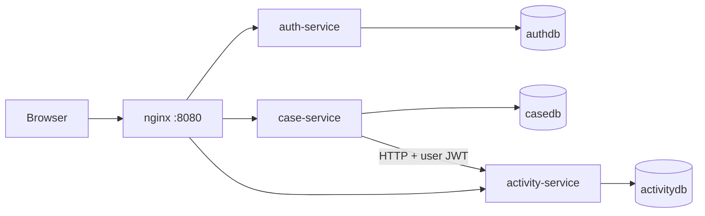

# Architecture

## Overview

Three Spring Boot services behind an nginx reverse proxy, each with its own PostgreSQL database. The React frontend is a static bundle served by the same nginx, so the browser talks to one origin and CORS is not needed in the Docker setup.

## Request flow: approving a case

1. The manager drags a card to Approved. The UI updates the card at once (optimistic update).
2. `PATCH /api/cases/{id}/status` reaches nginx, then case-service.
3. Case-service validates the JWT signature and expiry, maps the `roles` claim to authorities, and checks that the role may set this status.
4. The new status is saved in `casedb`.
5. Case-service calls activity-service with the same JWT to record a `STATUS_CHANGE` entry. The author comes from the token.
6. If the server rejected the change, the UI rolls the card back and shows an error.

## Data model

- `authdb.users(id, username, password_hash, role, enabled, created_at)`
- `casedb.cases(id, case_number, customer_name, title, description, status, priority, created_by, created_at, updated_at, version)` plus the sequence `case_number_seq`
- `activitydb.activities(id, case_id, type, content, created_by, created_at)`, append-only. `case_id` is a reference by value, with no foreign key across databases.

## Key design points

- Stateless services, so each can be scaled and deployed independently.
- Database per service; services share nothing but HTTP APIs.
- Flyway owns the schema; Hibernate only validates it.
- DTOs everywhere; entities are never exposed.
- Package-by-feature layout inside each service.